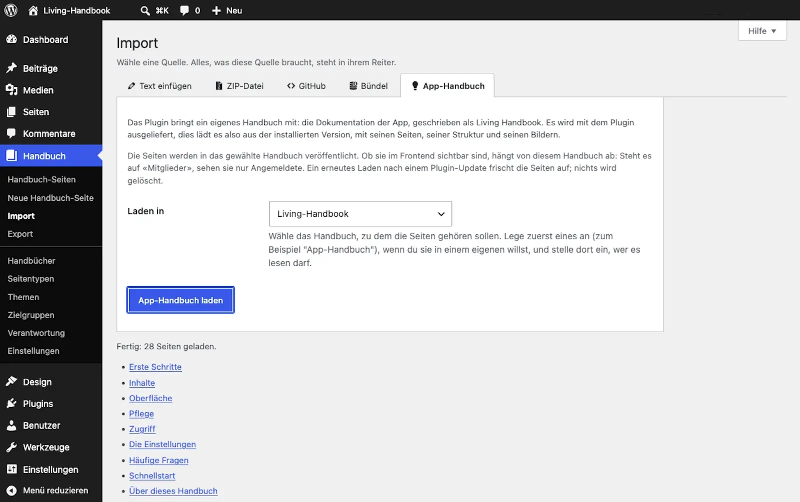

# App-Handbuch laden

Living Handbook bringt vier Handbücher mit: dieses Benutzerhandbuch auf Deutsch und Englisch, und die technische Dokumentation in denselben zwei Sprachen. Du lädst sie mit einem Klick in deine eigene Installation. Damit hast du die Anleitung direkt in WordPress, und zugleich siehst du ein fertiges, gefülltes Handbuch als Beispiel.

Voraussetzungen: Was du brauchst

* Ein Benutzerkonto mit der Rolle Redakteur oder höher. Das Laden veröffentlicht ein ganzes Handbuch auf einmal, darum genügt das Recht, eigene Seiten zu bearbeiten, nicht.
* Ein Handbuch als Ziel, zum Beispiel eines mit dem Namen „App-Handbuch“. Lege es vorher an, siehe [Erstes Handbuch anlegen](erstes-handbuch-anlegen.md). Bestimme dort auch, wer es lesen darf.

Das Handbuch liegt im Plugin, du brauchst also keine Internetverbindung, um es zu laden.

## Schritte

1. Öffne **Handbuch → Import** und wechsle auf den Reiter **App-Handbuch**.
2. Wähle unter **Welches Handbuch** aus, was du laden willst.
3. Wähle unter **Laden in** das Ziel-Handbuch aus.
4. Entscheide unter **Verbindung zur Quelle**, ob die Seiten am mitgelieferten Stand hängen bleiben sollen. Siehe unten.
5. Klicke auf **Handbuch laden**.
6. Lies die Ergebnisliste. Sieh dir danach das geladene Handbuch auf der Website an.

Willst du mehrere davon, wiederhole das mit einem anderen Ziel-Handbuch. Zwei Handbücher in einem Ziel zu mischen ergibt eine unübersichtliche Navigation.

### Verbindung zur Quelle

Der Haken ist gesetzt, und das ist für den Normalfall richtig: die Seiten sind im Editor gesperrt und ein späteres Laden frischt sie auf, das Handbuch folgt also dem Plugin.

Nimm den Haken weg, wenn du ein mitgeliefertes Handbuch als Vorlage für dein eigenes nehmen willst. Dann kommen die Seiten als gewöhnliche Handbuch-Seiten an, die du frei bearbeitest. Der Preis: sie altern. Ein Plugin-Update rührt sie nicht mehr an, und was sich in der Vorlage ändert, erfährst du nicht. Lädst du später trotzdem noch einmal in dasselbe Handbuch, überschreibt das auch diese Seiten, mit oder ohne Haken; lade eine Vorlage, die du bearbeitest, deshalb nie ein zweites Mal in dasselbe Ziel.

## Ergebnis

Alle Seiten dieses Handbuchs stehen jetzt in deinem gewählten Handbuch, samt Navigation und Bildern. Sie sind sofort veröffentlicht. Wer die Seiten sehen darf, bestimmt allein die Sichtbarkeit des Ziel-Handbuchs. Steht es auf „Alle Mitglieder“, lesen nur Angemeldete. Öffentlich wird es erst, wenn du das Handbuch auf „Öffentlich“ stellst.

Konzept: Warum das Handbuch zur Version passt

Das Handbuch wird mit dem Plugin ausgeliefert. Der Reiter **App-Handbuch** lädt es aus dem Plugin selbst. So passt die Anleitung immer zur installierten Version, und deine Website braucht dafür kein Internet. Aktualisierst du das Plugin, kommt das passende Handbuch mit; ein erneutes Laden über den Reiter frischt die Seiten dann auf. Geladen wird nie automatisch, nur wenn du es anstößt.

Die Texte werden weiterhin öffentlich auf GitHub geschrieben und beim Erstellen des Plugins hineinkopiert. Wer lieber den neuesten Stand direkt von GitHub zieht, kann den Reiter per Entwickler-Filter dorthin umleiten, siehe die Entwickler-Dokumentation.

Welches der vier Handbücher du lädst, wählst du unter **Welches Handbuch**. Vorausgewählt ist das Benutzerhandbuch in der Sprache deiner Verwaltung, die anderen drei stehen gleich daneben zur Wahl.

Stolpersteine: Drei Eigenheiten dieses Imports

* **Die Seiten sind sofort veröffentlicht.** Jeder andere Import legt erst unveröffentlichte Entwürfe an. Hier ist das anders, mit Absicht: Es ist die geprüfte Dokumentation des Plugins, und wer sie sehen darf, regelt ohnehin das Ziel-Handbuch.
* **Ein erneutes Laden überschreibt die Seiten.** Mit gesetztem Haken bei **Verbindung zur Quelle** sind die geladenen Seiten im Editor gesperrt, du kannst sie also gar nicht bearbeiten. Ohne Haken kannst du es, aber ein erneutes Laden in dasselbe Handbuch ersetzt sie trotzdem durch die mitgelieferte Fassung. Eigene, dauerhafte Änderungen machst du deshalb in einem eigenen Handbuch, nicht in den geladenen App-Handbuch-Seiten.
* **Ein erneutes Laden löscht nichts.** Es aktualisiert die Seiten, die es noch gibt, und legt neue an. Eine Seite, die in einer neueren Plugin-Version entfernt oder umbenannt wurde, bleibt dagegen als alte Seite in deinem Handbuch stehen, samt ihrem Platz in der Navigation. So findest du sie: Die Ergebnisliste nach dem Laden nennt jede Seite, die geladen wurde. Öffne danach **Handbuch-Seiten**, filtere nach dem Ziel-Handbuch und vergleiche. Was dort steht, aber nicht in der Ergebnisliste, ist ein Überbleibsel; verschiebe es in den Papierkorb.

## Verwandte Seiten

* [Markdown importieren](../inhalte/markdown-importieren.md)
* [GitHub-Synchronisation](../inhalte/github-synchronisation.md)
* [Sichtbarkeit einstellen](../zugriff/sichtbarkeit-einstellen.md)

## Transport-Metadaten
* Seitentyp: Anleitung
* Verantwortliche Rolle: Handbuch-Redaktion
* Thema: Einstieg
* Zielgruppe: Alle Mitglieder
* Eltern-Seite: Erste Schritte
* Reihenfolge: 5
* Textauszug: Dieses Handbuch wird mit dem Plugin ausgeliefert und lässt sich mit einem Klick in deine eigene Installation laden, passend zur installierten Version.
* Letzte Aktualisierung: 2026-10-26
* Letzte Prüfung: 2026-07-23
* Prüfintervall: 90 Tage
