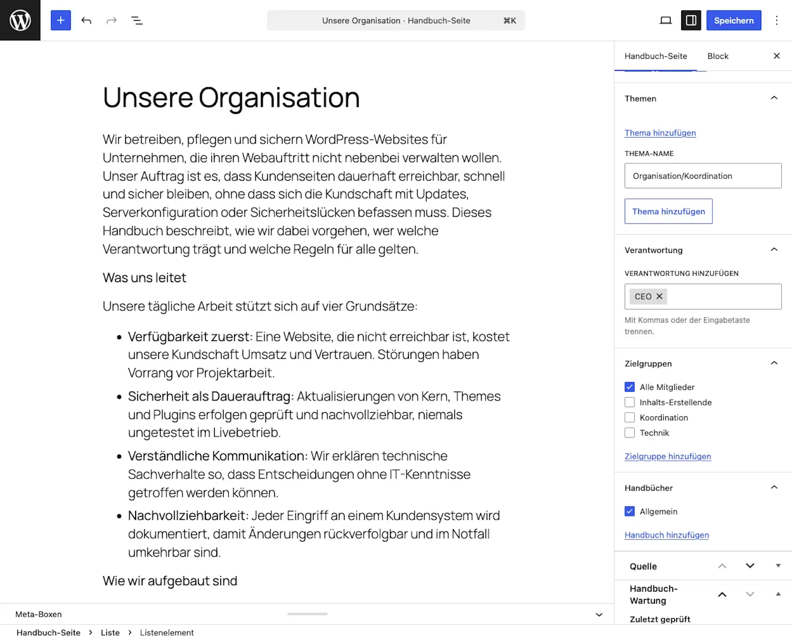

# Erste Seite anlegen

Diese Anleitung erstellt deine erste Handbuch-Seite. Die Schritte: schreiben, einem Handbuch zuweisen, klassifizieren, Prüfdaten setzen, veröffentlichen.

Voraussetzungen: Was schon da sein muss

* Ein angelegtes Handbuch, siehe [Erstes Handbuch anlegen](erstes-handbuch-anlegen.md).
* Ein Benutzerkonto, das Seiten schreiben darf, zum Beispiel mit der Rolle Autor, Redakteur oder Administrator. Mit der Rolle Mitarbeiter schreibst du einen Entwurf, veröffentlichen muss ihn dann jemand aus der Redaktion. Deine eigene Seite kannst du bearbeiten und ansehen, auch bevor sie einem Handbuch gehört.

## Schritte

1. Öffne **Handbuch-Seiten → Neue Handbuch-Seite**. Es öffnet sich der gewohnte Block-Editor, zuerst mit einer Auswahl an Vorlagen (in WordPress auch „Patterns“), eine pro Seitentyp: Anleitung, Prozessbeschreibung, Tool-Übersicht, Rolle/Organisation, Hintergrund/Konzept, FAQ und Bereichs-Übersicht.
2. Wähle die Vorlage, die zu deiner Seite passt, oder schließe die Auswahl für eine leere Seite. Eine Vorlage bringt nur die Gliederung mit: Überschriften, zugeklappte Bereiche und leere Absätze, deren grauer Platzhalter sagt, was hineingehört. Was du nicht füllst, bleibt auf der Website unsichtbar. Den Seitentyp setzt die Vorlage nicht, den wählst du in Schritt 5.
3. Schreibe die Seite: ein klarer Titel, ein kurzer Einleitungssatz, dann der Inhalt.
4. **Weise die Seite in der Seitenleiste einem Handbuch zu.** Diesen Schritt übersehen fast alle. Eine Seite ohne Handbuch bleibt auf der Website unsichtbar.
5. **Ordne die Seite ein**, ebenfalls in der Seitenleiste. Wähle den Seitentyp (zum Beispiel Anleitung oder Hintergrund), ein Thema, die Zielgruppe und die verantwortliche Rolle. Aus diesen Angaben entstehen die Abzeichen auf der Seite und die Filter auf der Einstiegsseite des Handbuchs. Eigene Begriffe legst du zentral an, siehe [Einordnung und Rollen pflegen](../pflege/schlagworte-und-rollen.md).
6. Fülle den Kasten **Handbuch-Wartung** unten im Editor aus: verantwortliche Rolle, letzte Prüfung, Prüfintervall. Auch grobe Werte sind besser als keine. Verfeinern kannst du später. Was diese Felder bewirken, erklärt [Der Prüfzyklus](../pflege/der-pruefzyklus.md).
7. Klicke auf **Veröffentlichen**.

## Ergebnis

Die Seite ist auf der Website erreichbar, unter `/handbook/<seitenname>/`. Auf der Einstiegsseite ihres Handbuchs erscheint sie unter „Zuletzt aktualisiert“. Oben zeigt sie die Abzeichen, rechts das Verzeichnis „Auf dieser Seite“. Ganz unten stehen die Angaben zur Seite, mit dem Prüfstatus als Abzeichen.

Stolpersteine: „Meine Seite erscheint nicht“

Fast immer hat das eine von drei Ursachen: Die Seite hat kein Handbuch zugewiesen. Oder das Handbuch ist für die aktuelle Besucherin nicht sichtbar. Oder die Seite ist noch ein Entwurf. Die Prüfreihenfolge und die Lösungen stehen unter [Häufige Fragen](../haeufige-fragen.md).

## Verwandte Seiten

* [Seiten ordnen](seiten-ordnen.md)
* [Seiten prüfen](../pflege/seiten-pruefen.md)
* [Inhalte schreiben](../inhalte/inhalte-schreiben.md)

## Transport-Metadaten
* Seitentyp: Anleitung
* Verantwortliche Rolle: Handbuch-Redaktion
* Thema: Einstieg
* Zielgruppe: Alle Mitglieder
* Eltern-Seite: Erste Schritte
* Reihenfolge: 3
* Textauszug: Diese Anleitung erstellt deine erste Handbuch-Seite: schreiben, einem Handbuch zuweisen, klassifizieren, Prüfdaten setzen, veröffentlichen.
* Letzte Aktualisierung: 2026-11-09
* Letzte Prüfung: 2026-07-23
* Prüfintervall: 180 Tage
