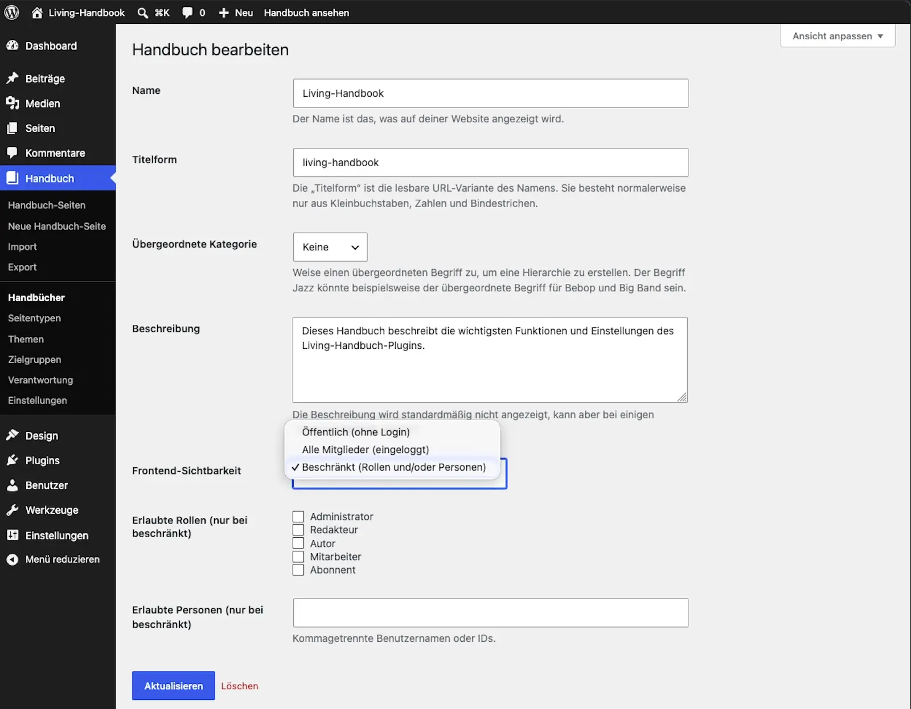

# Sichtbarkeit einstellen

Die Sichtbarkeit wird pro Handbuch geregelt, nicht pro Seite. Diese Anleitung stellt ein, wer ein Handbuch auf der Website lesen darf.

## Schritte

1. Öffne **Handbuch → Handbücher** und bearbeite das Handbuch.
2. Wähle eine der drei Stufen:
   * **Öffentlich:** Alle können lesen, auch ohne Anmeldung.
   * **Alle Mitglieder (angemeldet):** Nur wer auf der Website angemeldet ist, kann lesen. Das ist die Voreinstellung für jedes neue Handbuch. In einem Netzwerk aus mehreren Websites braucht die Person zudem ein Konto auf dieser Website; ein Konto auf einer anderen Website des Netzwerks genügt nicht.
   * **Eingeschränkt:** Nur bestimmte Benutzerrollen und/oder einzeln benannte Personen können lesen.
3. Bei **Eingeschränkt**: Wähle die Rollen aus. Ergänze bei Bedarf einzelne Personen.
4. Speichere.

> **Wichtig:** Die Stufen gelten für alle außer der Administration. Administratorinnen und Administratoren lesen jedes Handbuch vollständig, auch ein eingeschränktes: die Seiten, die Einstiegsseite, den Eintrag in der Übersicht und die Lernpfade. Alle anderen, die Redaktion eingeschlossen, lesen nur, was das Handbuch ihnen freigibt. Soll die Redaktion ein eingeschränktes Handbuch lesen, hake bei den Rollen **Redakteur** an oder trage die Personen einzeln ein. Lässt du beides weg, bleibt das Handbuch der Administration vorbehalten.

## Ergebnis

Die Regel wirkt sofort und überall: auf der Handbuch-Übersicht, auf den Seiten, in der Suche, in den Filtern und im Menü. Ein gesperrtes Handbuch taucht für diese Person nirgends auf, auch nicht als Name in einer Liste. Wer angemeldet ist und eine Seite eines gesperrten Handbuchs direkt aufruft, sieht den Hinweis „Kein Zugriff auf dieses Handbuch“ mit dem eigenen Namen, oder die Seite, die unter [Einstellungen → Zugriff](../die-einstellungen.md#zugriff) als **Seite bei fehlendem Zugriff** gewählt ist. Abgemeldete werden zur Anmeldung geleitet.

Dieselbe Regel gilt in der WordPress-Verwaltung. Seiten anderer Personen in einem Handbuch, das jemand nicht lesen darf, fehlen dort in der Seitenliste, ihre Dateien in der Mediathek und ihre Kommentare in der Kommentarliste; öffnen, bearbeiten oder löschen lassen sie sich nicht. Das Handbuch selbst fehlt in der Liste unter **Handbuch → Handbücher**, in der Handbuch-Auswahl des Editors und in den Auswahllisten von Import, Export und Seitenliste. Seine Einstellungen kann nur ändern, wer es lesen darf. Eigene Seiten bleiben immer sichtbar und bearbeitbar.

**Kommentare folgen ihrer Seite.** Wer eine Seite lesen darf, sieht ihre Kommentare und kann, solange sie offen sind, einen schreiben. Wer sie nicht lesen darf, sieht sie weder auf der Website noch über die Schnittstelle. Das Recht, eine eigene Seite zu bearbeiten, zählt dabei nicht: Schließt dich das Handbuch aus, fehlen dir ihre Kommentare auf der Website. In der Verwaltung zählen dazu die eigenen Seiten immer. Die Kommentarliste zeigt dort also die Kommentare zu genau den Seiten, die auch deine Seitenliste zeigt.

Stolpersteine: Typische Überraschungen

* **„Ich sehe mein Handbuch nicht“:** Du bist vermutlich abgemeldet, und das Handbuch steht auf „Alle Mitglieder“. Teste die Sicht deiner Leserinnen in einem privaten Browserfenster.
* **Teste nie als Administration.** Mit einem Administrator-Konto siehst du jede Seite, auch solche, die deine Leserinnen nicht sehen. Prüfe die Sicht mit einem Konto, das dieselbe Rolle hat wie deine Leserinnen.
* **Sperr dich nicht selbst aus.** Wer ein Handbuch nicht lesen darf, kann auch seine Einstellungen nicht mehr öffnen. Stellst du ein Handbuch auf **Eingeschränkt**, ohne deine eigene Rolle oder dich selbst anzuhaken, verschwindet es nach dem Speichern aus deiner Liste. Zurückholen kann es dann nur die Administration.
* **Eine Seite nur für die Administration braucht ein eigenes Handbuch.** Freigaben gibt es pro Handbuch, nicht pro Seite. Lege ein Handbuch auf **Eingeschränkt** an, ohne Rollen und ohne Personen, und verschiebe die Seite dorthin.
* **Eigene Seiten bleiben deine.** Wer eine Seite nach den Regeln von WordPress bearbeiten darf, kann sie im Block-Editor öffnen, speichern, in der Vorschau ansehen und auf der Website lesen. Für die eigenen Seiten gilt das immer, auch wenn das Handbuch dich sonst ausschließt, und auch für eine neue Seite, die noch keinem Handbuch gehört. Fremde Seiten in einem Handbuch, das du nicht lesen darfst, öffnest du dagegen nicht, auch nicht als Redakteurin. Autorinnen und Autoren bearbeiten nach den WordPress-Regeln ohnehin nur ihre eigenen Seiten, Mitarbeitende nur ihre eigenen Entwürfe. Listen, Suche und Navigation folgen der Sichtbarkeit des Handbuchs. Wer ein Handbuch nicht lesen darf, findet darin also auch die eigene Seite nicht über die Navigation.
* **Die Zahlen über der Seitenliste zählen alles.** „Alle (12)“ und die anderen Zähler nennen auch die Seiten, die die Liste darunter für dich ausblendet. Das Plugin passt diese Zahlen nicht an.
* **Beim Umzug auf eine andere Website reisen einzeln freigegebene Personen nicht mit.** Siehe [Handbuch umziehen](../inhalte/handbuch-umziehen.md).
* **Einzeln freigegebene Personen sind Personendaten.** Unter **Werkzeuge → Personenbezogene Daten exportieren** erscheint eine solche Person mit den Handbüchern, die sie einzeln nennen. **Personenbezogene Daten löschen** lässt den Eintrag stehen und meldet ihn, denn sonst verlöre ein aktives Konto still seinen Zugang. Soll die Person ein Handbuch nicht mehr lesen, nimm sie am Handbuch selbst heraus. Wird ein Konto gelöscht, verschwindet es aus allen Zugriffslisten.

## Verwandte Seiten

* [Zugriff verstehen](zugriff-verstehen.md)
* [Erstes Handbuch anlegen](../erste-schritte/erstes-handbuch-anlegen.md)

## Transport-Metadaten
* Seitentyp: Anleitung
* Verantwortliche Rolle: Handbuch-Redaktion
* Thema: Zugriff
* Zielgruppe: Alle Mitglieder
* Eltern-Seite: Zugriff
* Reihenfolge: 1
* Textauszug: Die Sichtbarkeit wird pro Handbuch geregelt; diese Anleitung stellt ein, wer ein Handbuch auf der Website lesen darf.
* Letzte Aktualisierung: 2026-11-10
* Letzte Prüfung: 2026-07-23
* Prüfintervall: 90 Tage
