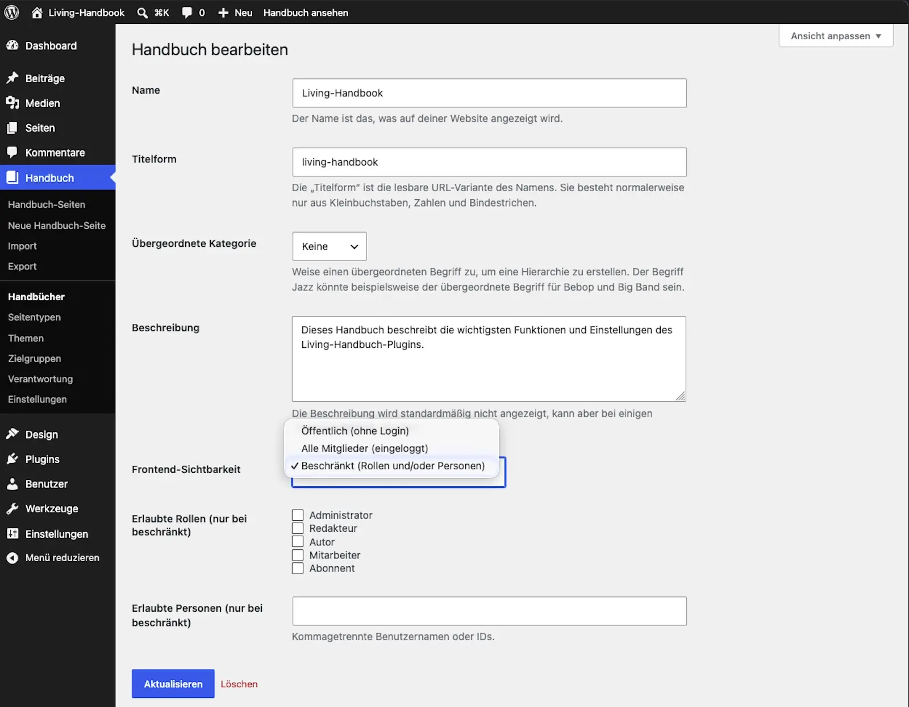

# Set visibility

Visibility is controlled per handbook, not per page. This guide sets who may read a handbook on the website.

## Steps

1. Open **Handbook → Handbooks** and edit the handbook.
2. Choose one of the three levels:
   * **Public:** Everyone can read, even without logging in.
   * **All members (logged in):** Only people logged in to the website can read. This is the default for every new handbook.
   * **Restricted:** Only specific user roles and/or individually named people can read.
3. For **Restricted**: pick the roles. Add individual people if needed.
4. Save.

> **Important:** The levels do not apply to editors. Anyone who may edit other people's posts, that is the WordPress roles Editor and Administrator, reads every handbook page, in a restricted handbook too, and without being on its list of roles or people. A handbook hidden from your editors cannot be set up with the built-in levels. Only the entry page, the overview and the menu follow the levels for editors too: a restricted handbook an editor is not listed on is missing from their overview, but they still open its pages.

## Result

The rule takes effect immediately and everywhere: on the handbook overview, on the pages, in the search, in the filters and in the menu. A handbook someone may not read appears nowhere for that person, not even as a name in a list. Someone logged in who opens a page of a handbook they may not read sees the notice "No access to this handbook" with their own name, or the page chosen as **No-access page** under [Settings → Access](../the-settings.md#access). Logged-out people are sent to the login.

Pitfalls: Typical surprises

* **"I cannot see my handbook":** You are probably logged out, and the handbook is set to "All members". Test your readers' view in a private browser window.
* **Never test as an editor.** With an Editor or Administrator account you see every page, including the ones your readers do not. Check the view with an account that has the same role as your readers.
* **Editing in the block editor requires reading.** Who may edit pages is decided by the WordPress user roles. Authors and contributors, however, can only open a handbook page in the block editor if they may read its handbook. A new page that belongs to no handbook yet cannot be opened by them at all. New pages are therefore best created by an editor, who assigns them to a handbook straight away.
* **When moving to another website, individually allowed people do not travel along.** See [Move a handbook](../content/move-a-handbook.md).

## Related pages

* [Understanding access](understanding-access.md)
* [Create your first handbook](../getting-started/create-your-first-handbook.md)

## Transport-Metadaten
* Seitentyp: Guide
* Verantwortliche Rolle: Handbook editors
* Thema: Access
* Zielgruppe: All members
* Eltern-Seite: Access
* Reihenfolge: 1
* Textauszug: Visibility is controlled per handbook; this guide sets who may read a handbook on the website.
* Letzte Aktualisierung: 2026-10-26
* Letzte Prüfung: 2026-07-27
* Prüfintervall: 90 Tage
