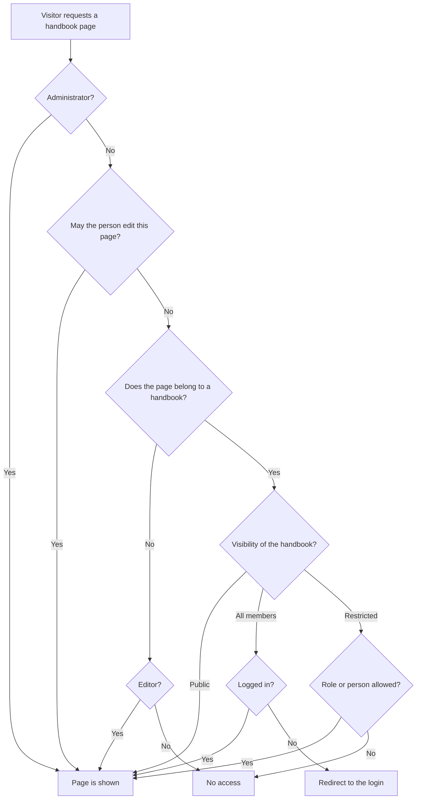

# Understanding access

This page answers one question: why does Living Handbook rather show nothing than give something away by accident? Once you know this principle, every "Why can't I see anything?" makes sense immediately.

## What this is about

An internal handbook contains things that should not be public: processes, responsibilities, internal addresses. The most expensive mistake of such a system is not an invisible page. The most expensive mistake is an accidentally public page. Living Handbook therefore follows one simple ground rule: when in doubt, hide. Specialists call this principle "fail-closed".

The diagram shows the decision path when a page is requested: from the role through the right to edit, the handbook assignment and the visibility to display, login or denial.

## Why it is built this way

* **One rule per handbook instead of per page.** Visibility per page sounds flexible. But it quickly turns unmanageable, because nobody keeps a hundred individual rules in their head. A rule per handbook fits in one sentence: "All logged-in people see the team handbook."
* **A page without a handbook is invisible.** It has no rule that could allow access. So the safe answer applies: no access. Only editors and administrators see it, so that someone can assign it to a handbook. This is the most common cause of "my page does not show up", see [Frequently asked questions](../faq.md).
* **There is one central checkpoint.** Every place that shows handbook content first asks the same question: may this person read this? That holds for pages, search, filters, menu, feedback and comments: whoever may read a page sees its comments. There is no back door that could be forgotten.
* **The side paths are closed too.** Handbook pages do not appear in the technical lists that search engines and other websites read out. An internal handbook leaves no public traces.

One consequence you need to know: this restraint also applies to public handbooks. Their pages can be opened by anyone, but search engines find them less well than normal pages. The plugin is built for internal handbooks; a public product documentation with search-engine ambitions is not its core use.

## What this means for your work

* **Only administrators see everything.** Administrators read every handbook in full, restricted ones too: the pages, even those without a handbook assignment, the entry page, the entry in the overview and the learning paths. Editors read what a handbook grants them, like everyone else. A restricted handbook without the Editor role ticked therefore stays reserved for administrators. That is also why a test with an administrator account misleads: check the view with an account that has your readers' role.
* **Whoever may edit a page may also read it.** An author opens their own page in the block editor, in the preview and on the website, even when the handbook otherwise excludes them. Other people's pages, lists, search and navigation still follow the visibility for them.
* **The admin follows the same rule.** In the WordPress admin, other people's pages from handbooks you may not read are missing: from the page list, from the media library and from the comments. You cannot open, edit or delete them, and you can neither configure nor delete the handbook itself. Only the counts above the page list still include such pages.
* A new handbook starts on **All members**. It becomes public only through your deliberate decision.
* An imported handbook also starts on **All members**, whatever the source says.
* When something does not show up, it is almost never a bug but the protection logic. Check the handbook assignment and the visibility before you look further.

Background: For developers

The central check is filterable, for example to give a service account read access to everything. The capability with which administrators read every handbook can be changed too, for example so that editors read every handbook as well. Your own read paths must always route through this check. How that works is in the [developer documentation on the hooks](https://github.com/rfluethi/living-handbook/blob/main/docs/technical/en/living-handbook-technical/hooks.md).

## Images and files

An image that belongs to a handbook page inherits that page's access: it is listed neither in the media endpoint nor in the admin's media library, and someone who may not open the page cannot read its entry either.

The file itself is protected too, as soon as its handbook is not public. Living Handbook then keeps it in a folder of its own and hands it out only to someone who may read the page; anyone else does not get it, even with the address. For that to work the web server needs a rule. How to check that it works is described in [Protect files](protect-files.md).

## Related pages

* [Set visibility](set-visibility.md)
* [Protect files](protect-files.md)
* [Frequently asked questions](../faq.md)

## Transport-Metadaten
* Seitentyp: Background / Concept
* Verantwortliche Rolle: Handbook editors
* Thema: Access
* Zielgruppe: All members
* Eltern-Seite: Access
* Reihenfolge: 2
* Textauszug: Living Handbook rather hides than gives something away by accident; this page explains the fail-closed principle.
* Letzte Aktualisierung: 2026-11-09
* Letzte Prüfung: 2026-07-27
* Prüfintervall: 365 Tage
