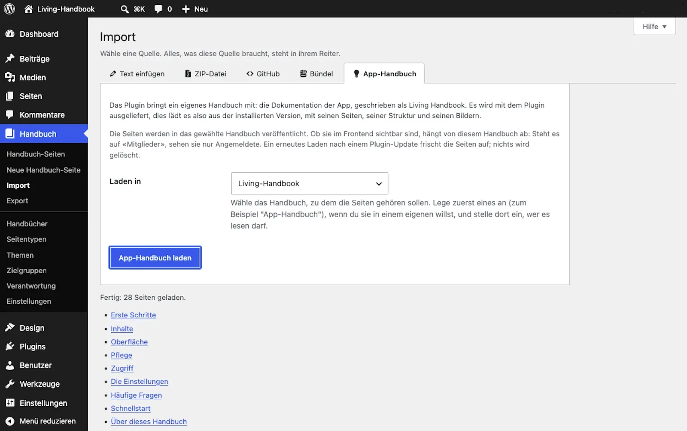

# Load the app handbook

Living Handbook ships with four handbooks: this user handbook in German and English, and the technical documentation in the same two languages. You load them into your own installation with one click. That gives you the guide right inside WordPress, and at the same time a finished, filled handbook as an example.

Requirements: What you need

* A user account with the role Editor or higher. Loading publishes a whole handbook at once, so the right to edit your own pages is not enough.
* A handbook as the target, for example one called "App handbook". Create it first, see [Create your first handbook](create-your-first-handbook.md). Decide there who may read it.

The handbook ships inside the plugin, so you need no internet connection to load it.

## Steps

1. Open **Handbook → Import** and switch to the **App handbook** tab.
2. Under **Which handbook**, choose what to load.
3. Under **Load into**, choose the target handbook.
4. Under **Connection to the source**, decide whether the pages stay tied to the shipped copy. See below.
5. Click **Load handbook**.
6. Read the result list. Then look at the loaded handbook on the website.

If you want more than one, repeat this with another target handbook. Mixing two handbooks into one target gives you a navigation nobody can read.

### Connection to the source

The box is ticked, and for the normal case that is right: the pages are locked in the editor and a later load refreshes them, so the handbook follows the plugin.

Untick it when you want to use a shipped handbook as the template for your own. The pages then arrive as ordinary handbook pages you can edit freely. The price: they age. A plugin update no longer touches them, and you will not hear about what changed in the template. A later load into the same handbook leaves these pages untouched too, so your changes are kept, and the result list says so. If you do want the fresh edition of such a page, move it to the trash first and then load again.

## Result

All pages of this handbook are now in your chosen handbook, including navigation and images. They are published right away. Who may see the pages is decided solely by the visibility of the target handbook. If it is set to "All members", only logged-in people can read. It becomes public only when you set that handbook to "Public".

Concept: Why the handbook matches your version

The handbook ships with the plugin. The **App handbook** tab loads it from the plugin itself. So the guide always matches the installed version, and your website needs no internet for it. When you update the plugin, the matching handbook comes along; loading it again through the tab then refreshes the pages. Loading never happens automatically, only when you trigger it.

The texts are still written in public on GitHub and copied into the plugin when it is built. If you would rather pull the latest state straight from GitHub, a developer filter can point the tab there, see the developer documentation.

Which of the four handbooks you load is chosen under **Which handbook**. The user handbook in the language of your admin is preselected; the other three are right next to it.

Pitfalls: Three peculiarities of this import

* **The pages are published immediately.** Every other import first creates unpublished drafts. Here it is different, on purpose: this is the plugin's reviewed documentation, and who may see it is governed by the target handbook anyway.
* **Loading again overwrites only connected pages.** With **Connection to the source** ticked, the loaded pages are locked in the editor, and loading again replaces them with the shipped edition. Pages that were loaded unticked are left as they are, and the result list names them. To get the fresh edition of such a page, move it to the trash and load again.
* **Loading again deletes nothing.** It updates the pages that still exist and creates new ones. A page that a newer plugin version removed or renamed stays behind in your handbook as an old page, with its place in the navigation. The result list after loading names such pages that no longer belong to the shipped handbook. They are not deleted; if you no longer need one, move it to the trash by hand.

## Related pages

* [Import Markdown](../content/import-markdown.md)
* [GitHub sync](../content/github-sync.md)
* [Set visibility](../access/set-visibility.md)

## Transport-Metadaten
* Seitentyp: Guide
* Verantwortliche Rolle: Handbook editors
* Thema: Getting started
* Zielgruppe: All members
* Eltern-Seite: Getting started
* Reihenfolge: 5
* Textauszug: This handbook ships with the plugin and loads into your own installation with one click, matching the installed version.
* Letzte Aktualisierung: 2026-10-27
* Letzte Prüfung: 2026-07-27
* Prüfintervall: 90 Tage
